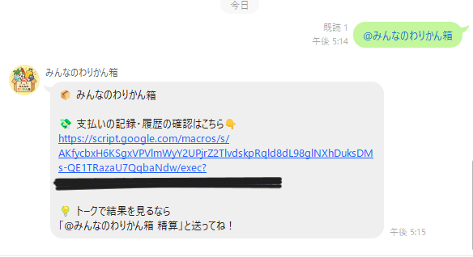
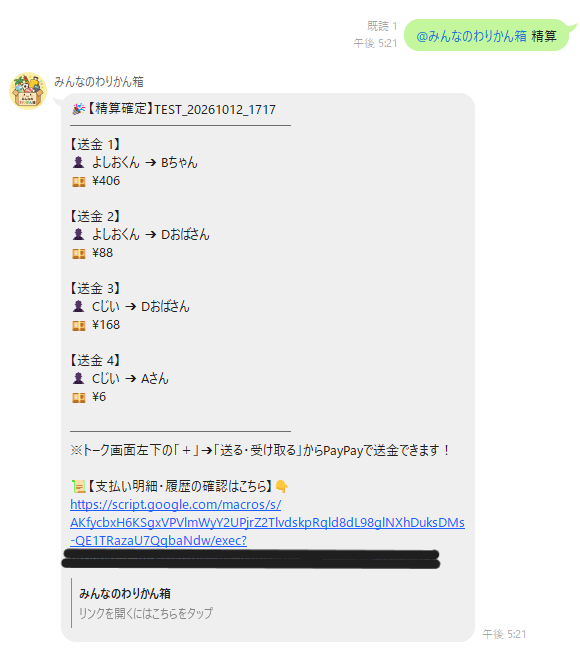
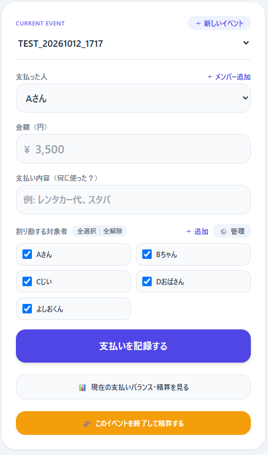
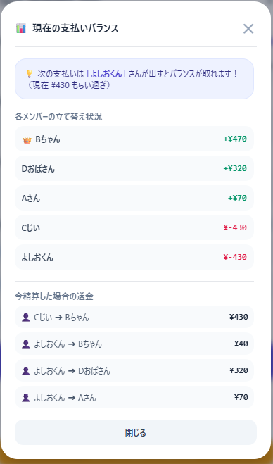
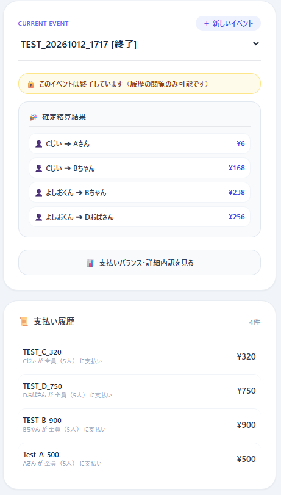

# 📦 みんなのわりかん箱 (Warikan Box)
> **LINEグループでメンションするだけで、全員が電卓いらずになる完全無料・現場密着型の割り勘SaaS**

---

## 📸 スクリーンショット

### 1. LINEトーク画面（直感的な呼び出し ＆ 精算結果）
|               メンションで案内カードを召喚                |          「@みんなのわりかん箱 精算」で一発集計          |
| :-------------------------------------------------------: | :------------------------------------------------------: |
|  |  |

### 2. Webアプリケーション（入力・試算・確定）
|           支払い入力フォーム (active)            |            リアルタイム試算＆レコメンド             |         精算確定・閲覧専用モード (closed)          |
| :----------------------------------------------: | :-------------------------------------------------: | :------------------------------------------------: |
|  |  |  |

---

## 🎯 プロジェクト概要

旅行や飲み会の割り勘で、幹事が直面する以下の**「リアルな現場のペイン」**を解決するために開発したWebアプリケーションです。

* ❌ **既存アプリの壁:** 「このアプリ入れて！」「会員登録して！」と周りに頼むのが気まずい・面倒。
* ❌ **計算の泥沼:** 立替が複数人にまたがり、「誰が誰にいくら送金すればいいか」の計算が合わず揉める。
* ❌ **Bot運用の罠:** LINE公式アカウントの無料枠（月200通）がグループ会話ですぐに枯渇して停止する。

**『みんなのわりかん箱』は、LINEのグループチャットにBotを招待し、`@みんなのわりかん箱` と呼ぶだけで、メンバー全員がアプリインストール不要・規約同意不要で即座に割り勘を開始できます。**

---

## ✨ コア機能

1. **💸 スムーズな支払い記録 (Web UI):**
   * スマホに最適化したTailwind CSSによる爆速フォーム。
   * 金額の3桁カンマ補正、9,999万円までの物理リミッター、対象者の「全選択/全解除」ボタンを完備。
2. **🧮 最小送金回数アルゴリズム（数学的相殺）:**
   * 各自の「立替額 - 負担額」を算出し、最大債権者と最大債務者をぶつける貪欲法（Greedy）により、**グループ全体の移動金額・送金回数を数学的な最小手**へ圧縮。
3. **📊 リアルタイム試算＆「次は誰が払う？」レコメンド:**
   * 入力画面の横で、現在の収支バランスをワンタップで確認可能。
   * 「今一番マイナスが大きい人」を自動検知し、**「💡 次の支払いは〇〇さんが出すとバランスが取れます！」** とサジェスト。
4. **🗑️ 支払いの論理削除（監査ログの保護）:**
   * 入力ミスの取消時、行を物理削除せず `deleted` フラグで管理。
   * 履歴には「打消線＋取消済バッジ」で残るため、「勝手に消された？」という人間関係の不信感を構造的に防止。
5. **🔒 イベント管理 ＆ 終了時ロック:**
   * 1つのグループ内で「北海道旅行」「週末BBQ」などイベント単位で管理可能。
   * 精算確定後はフォームが自動ロックされ、確定明細の「閲覧専用モード」へ安全に切り替え。

---

## 🛡️ 現場目線の防弾アーキテクチャ（エンジニアリングのこだわり）

本プロダクトは、単に「動く」だけではなく、**商用レベルの運用モラル・セキュリティ・コストゼロ設計**を徹底しています。

### 1. 「利用規約同意を他人に押し付けない」完全オプトイン設計
幹事が導入したツールに対し、他の参加者までLINEアカウント連携や規約同意を強制されるのはプライバシーモラルに反します。
* **解決策:** 幹事が「名前（文字列）」を入れるだけで全員が計算に参加可能。LINE UserIDとの紐付けを一切強制しないプライバシー防衛設計を確立。

### 2. LINE公式アカウント「月200通無料枠死」の完全回避
グループ内でBotがPush通知を乱発すると、LINE公式アカウントの月間上限（200通）に達して翌月まで停止します。
* **解決策:**
  * 通常の呼び出し・精算: 無料枠カウント対象外の **`Reply API`** で返信。
  * 入力通知: Botではなくユーザー自身の端末からグループへ共有する動線を採用。
  * **結果:** 送信数カウントを永久にゼロ付近に抑え、**完全無料での永久運用**を実現。

### 3. グループごとの完全データ分離（マルチテナント）
Botが発行するWebアプリURLに `?groupId=...` を付与し、GASのサーバーサイド（`doGet`）でHTMLテンプレートに変数を直焼きしてクライアントに配信。別グループのデータが混ざらない安全なデータ分離を達成。

### 4. XSS（クロスサイトスクリプティング）対策
悪意のある文字列（記号・スクリプトタグ）を含むメンバー名や用途メモが入力された場合でも画面が破壊されないよう、HTMLのインライン `onclick` 文字列展開を全廃。DOM作成時の純粋なJSイベントリスナーによる安全なバインドを徹底。

### 5. 法的リスクの防弾チョッキ（規約 ＆ 免責）
* 資金決済法リスクを排除するため、「送金・決済の非仲介」を明文化。
* 「計算結果の無保証」「機微な個人情報の非保持」「トラブル免責」を定めた利用規約・プライバシーポリシーページ（`?page=terms`）を完備。

---

## 🛠️ 技術スタック

| レイヤー | 技術 / サービス | 選定理由 |
| :--- | :--- | :--- |
| **Frontend** | HTML5, JavaScript (ES6), Tailwind CSS (CDN) | ビルド環境不要でGAS単体で動作し、初速0.1秒の高速レンダリングを実現 |
| **Backend** | Google Apps Script (GAS) | サーバー保守費0円、常時稼働、外部API連携が容易なサーバーレス環境 |
| **Database** | Google スプレッドシート | 無料で1,000万セルまで保持可能。視覚的なデータ確認・バックアップが容易 |
| **Messaging** | LINE Messaging API (Webhook / Reply / Push) | 日本の生活インフラであるLINE上で完結させ、参加障壁をゼロにする |

---

## 📐 データ構造（Google スプレッドシート）

### 1. `Events` シート（イベント管理）
| 列 | カラム名 | 説明 | 例 |
| :--- | :--- | :--- | :--- |
| A | **EventID** | イベント固有識別子 | `E001` |
| B | **GroupID** | LINEのグループ/ルーム識別子 | `C26f...` |
| C | **EventName** | イベント名 | `北海道旅行` |
| D | **Status** | 状態フラグ | `active` / `closed` |
| E | **CreatedAt** | 作成日時 | `2026/10/11 12:00:00` |

### 2. `Members` シート（参加者管理）
| 列 | カラム名 | 説明 | 例 |
| :--- | :--- | :--- | :--- |
| A | **GroupID** | 属するグループ識別子 | `C26f...` |
| B | **MemberID** | メンバー管理番号 | `M001` |
| C | **MemberName** | 画面表示用の名前（最大30文字） | `田中` |
| D | **LineUserID** | （任意）自発的名寄せ時のLINE ID | 空白 |
| E | **PayPayLink** | （任意）受け取り用リンク | 空白 |
| F | **Status** | 論理状態フラグ | `active` / `inactive` |

### 3. `Payments` シート（支払い履歴）
| 列 | カラム名 | 説明 | 例 |
| :--- | :--- | :--- | :--- |
| A | **PaymentID** | 支払い固有識別子 | `P001` |
| B | **EventID** | 紐付くイベント識別子 | `E001` |
| C | **PayerID** | 支払者のMemberID | `M001` |
| D | **Amount** | 金額（円） | `4500` |
| E | **Description** | 用途メモ（最大50文字） | `レンタカー代` |
| F | **TargetMemberIDs** | 割り勘対象のMemberIDリスト | `M001,M002,M003` |
| G | **CreatedAt** | 記録日時 | `2026/10/11 13:30:00` |
| H | **Status** | 論理削除フラグ | `active` / `deleted` |

---

## 🚀 セットアップ手順（デプロイ方法）

1. **Googleスプレッドシートの作成:**
   * スプレッドシートを新規作成し、シート名を `Events`, `Members`, `Payments` に変更。
2. **GASプロジェクトの作成:**
   * 「拡張機能」 > 「Apps Script」を開く。
   * 本リポジトリの `コード.gs`, `index.html`, `terms.html` をそれぞれ作成・配置。
3. **定数の設定 (`コード.gs`):**
   * `LINE_CHANNEL_ACCESS_TOKEN` に自身のLINEチャネルアクセストークンを設定。
4. **Webアプリとしてデプロイ:**
   * 「デプロイ」 > 「新しいデプロイ」 > 種類の選択: 「ウェブアプリ」。
   * 次のユーザーとして実行: **「自分」**
   * アクセスできるユーザー: **「全員」**（Anyone）
   * 発行されたURL（末尾が `/exec`）を `WEB_APP_URL` 定数に設定し、再デプロイ。
5. **LINE Developersコンソールの設定:**
   * Messaging APIの Webhook URL に上記GASの `/exec` URLを登録。
   * 「Webhookの利用」を **ON** に設定。

---

## ⚖️ 免責事項 ＆ プライバシー方針

本サービスは個人開発による無料ツールであり、送金・決済の仲介は一切行いません。
利用規約およびプライバシーポリシーの詳細は、アプリ内の `?page=terms` ページにて明文化されています。

---

## 👨‍💻 開発者 (Author)

* **Developer:** Liquid Gold Labs / beer.wa.dev
* **Philosophy:** 「最小単位でリリースし、現場の泥臭い課題をテクノロジーと防弾アーキテクチャで解決する」
